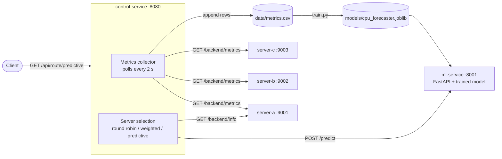

# ML-Based Predictive Dynamic Load Balancer

A final-year B.Tech major project (ABES Institute of Technology, Ghaziabad). It is a load balancer that does not only react to how busy servers are right now: it also predicts how busy each server will be a few seconds from now and routes requests to the server expected to be least loaded.

- **`control-service`** (Java 21, Spring Boot) is the load balancer. It collects live metrics from the backend servers, selects a server, and forwards requests.
- **`ml-service`** (Python, FastAPI) is a separate prediction service. It forecasts a server's CPU load about 6 seconds ahead using a trained model.
- **Backend servers** are three instances of the same Spring Boot application, started on ports 9001, 9002 and 9003.

## Architecture



**How a predictive request flows**

1. Every 2 seconds the collector reads CPU, memory and request rate from each backend and keeps the last 20 CPU readings per server. A backend that stops answering is marked `DOWN` and is skipped.
2. For each healthy server, the control service sends the current reading and recent CPU history to the ML service.
3. The ML service returns the predicted CPU load about 6 seconds ahead.
4. The server with the lowest predicted load receives the request.
5. If the ML service is unavailable, routing falls back to the weighted-load strategy, and the strategy name in the response shows that a fallback happened.

## Routing strategies

| Strategy | Endpoint | How it chooses |
|---|---|---|
| Round robin | `GET /api/route` | Cycles through healthy servers in order |
| Weighted load | `GET /api/servers/recommended` | Lowest score, where score = 0.5 x CPU + 0.3 x memory + 0.2 x normalized request rate |
| Predictive | `GET /api/route/predictive` | Lowest CPU predicted by the ML model |

## Repository structure

```
.
├── control-service/                 Spring Boot load balancer and backend server
│   ├── pom.xml
│   ├── data/metrics.csv             Collected training data
│   └── src/main/java/com/yuva/loadbalancer/
│       ├── controller/              LoadBalancerController, BackendController
│       ├── service/                 ServerSelectionService, MetricsCollector, MlClient,
│       │                            RequestRateTracker, RequestCountingFilter
│       └── model/                   ServerInfo, BackendMetrics, Prediction*, ...
├── ml-service/                      FastAPI prediction service
│   ├── app/main.py                  API (/health, /model-info, /predict)
│   ├── app/features.py              Feature engineering shared by training and serving
│   ├── train.py                     Training and evaluation script
│   ├── models/                      Saved model and results.json
│   └── requirements.txt
├── generate-load.ps1                Random load bursts used to create training data
└── README.md
```

## Prerequisites

- JDK 21
- Maven 3.9+
- Python 3.11+
- Windows PowerShell (the commands below are for PowerShell)

## Running the project

Open four PowerShell windows, one for each part, from the repository root.

### 1. ML service

```powershell
cd ml-service
python -m venv .venv
.\.venv\Scripts\Activate.ps1
pip install -r requirements.txt
uvicorn app.main:app --reload --port 8001
```

API docs: http://127.0.0.1:8001/docs

### 2. Backend servers (ports 9001, 9002, 9003)

Build the jar once:

```powershell
cd control-service
mvn clean package -DskipTests
```

Start three backends, each with its own port and ID. The collector is disabled on them because only the control service should collect metrics:

```powershell
$jar = "target\load-balancer-control-service-0.1.0.jar"
Start-Process powershell -ArgumentList "-NoExit","-Command","java -jar $jar --server.port=9001 --app.server-id=server-a --app.collector.enabled=false"
Start-Process powershell -ArgumentList "-NoExit","-Command","java -jar $jar --server.port=9002 --app.server-id=server-b --app.collector.enabled=false"
Start-Process powershell -ArgumentList "-NoExit","-Command","java -jar $jar --server.port=9003 --app.server-id=server-c --app.collector.enabled=false"
```

### 3. Control service (load balancer)

```powershell
cd control-service
mvn spring-boot:run
```

Do not use `mvn clean` while the backends are running, because it deletes the jar they were started from.

### 4. Check that it works

- http://localhost:8080/api/servers shows all three servers as `HEALTHY` with live metrics.
- http://localhost:8080/api/route/predictive returns a response from the selected backend.
- http://localhost:8080/api/ml-health shows that the ML service is up.

## API reference

### Control service (port 8080)

| Method | Path | Description |
|---|---|---|
| GET | `/api/servers` | Latest collected metrics for every server |
| GET | `/api/servers/round-robin` | Next server in round-robin order |
| GET | `/api/servers/recommended` | Server with the lowest weighted load score |
| GET | `/api/route` | Forward a request using round robin |
| GET | `/api/route/predictive` | Forward a request using the predictive strategy |
| GET | `/api/ml-health` | Health of the ML service |
| POST | `/api/predictions` | Get a prediction for one server |
| GET | `/actuator/health` | Spring Boot health check |

Example prediction request:

```powershell
$body = @{
  serverId = 'server-a'
  cpuPercent = 61
  memoryPercent = 48
  requestsPerSecond = 35
  recentCpuPercent = @(45, 49, 54, 58, 61)
} | ConvertTo-Json
Invoke-RestMethod -Method Post -Uri http://localhost:8080/api/predictions -ContentType 'application/json' -Body $body
```

### Backend servers (ports 9001-9003)

| Method | Path | Description |
|---|---|---|
| GET | `/backend/info` | Identifies the backend that answered |
| GET | `/backend/metrics` | CPU, heap memory and request rate of this backend |
| GET | `/backend/work?ms=300` | Burns CPU for the given time, used to create test load |

### ML service (port 8001)

| Method | Path | Description |
|---|---|---|
| GET | `/health` | Service status and loaded model |
| GET | `/model-info` | Training results of the saved model |
| POST | `/predict` | Predict CPU load about 6 seconds ahead |

## Metrics collected

Each backend reports metrics about its own process:

- **CPU**: process CPU usage from the JVM.
- **Memory**: used heap as a percentage of maximum heap.
- **Requests per second**: smoothed request rate over `/backend/*` endpoints.

The control service appends one row per server every 2 seconds to `control-service/data/metrics.csv`:

```
timestamp,server_id,cpu_percent,memory_percent,requests_per_second
```

## Machine learning

### Dataset

`generate-load.ps1` sends random bursts of work to random backends, with idle gaps in between, so the collected data contains both quiet and busy periods. Run it while the whole system is up:

```powershell
powershell -ExecutionPolicy Bypass -File .\generate-load.ps1
```

The current dataset has roughly 10,000 readings (about 3,500 per server). The load is synthetic, so results describe this test setup and not real production traffic.

### Task and features

- **Target**: the server's CPU 3 readings ahead (about 6 seconds).
- **Features** (`ml-service/app/features.py`): current CPU, memory and request rate; the four previous CPU readings; the mean and least-squares slope of the last five readings; and the latest CPU change.
- The same feature code is used for training and for live predictions, so the two cannot drift apart.

### Evaluation method

- Chronological split per server: the first 80% of the time is used for training and the last 20% for testing. Data is never shuffled.
- A gap of 3 readings between the two periods keeps training targets from overlapping the test period.
- Metrics: MAE and RMSE (lower is better).

### Training

```powershell
cd ml-service
.\.venv\Scripts\python.exe train.py
```

This trains the models, prints the comparison table, and saves the best model by RMSE to `models/cpu_forecaster.joblib` together with `models/results.json`.

### Results

Train rows: 9,135. Test rows: 2,279.

| Model | MAE | RMSE |
|---|---|---|
| Baseline: persistence (CPU stays the same) | 3.215 | 9.610 |
| Baseline: linear trend extrapolation | 4.393 | 12.682 |
| Ridge regression | 2.991 | 7.021 |
| Random forest | 3.272 | 7.148 |
| Gradient boosting | 3.184 | 6.938 |

How to read this:

- The trained models reduce RMSE by roughly 27-28% compared with the persistence baseline, so they mainly help with large errors, such as when a burst is starting or ending.
- Improvement in MAE is small, because most readings are idle and easy to predict for every method.
- Simple trend extrapolation performed worse than persistence.
- The differences between the three trained models are small and come from a single split, so gradient boosting should not be presented as clearly better than ridge regression. It was selected because it had the lowest RMSE on the test set, so its figures are slightly optimistic.

## Project status

| Area | Status |
|---|---|
| Round-robin, weighted-load and predictive routing | Done |
| Real metrics from backends, with health detection | Done |
| Metrics logging to CSV | Done |
| Training pipeline with chronological evaluation | Done |
| Serve the trained model through the FastAPI `/predict` endpoint | In progress |
| Move predictions into the collector loop (faster routing) | Planned |
| Load tests comparing the three strategies (latency, errors, load spread) | Planned |
| Accuracy report on busy periods only | Planned |
| Spring Cloud Gateway, Eureka, Prometheus and Grafana | Planned |

## Limitations

- The backend list is fixed in `MetricsCollector` (three servers on localhost).
- All servers run on one machine, so they compete for the same CPU.
- Memory is JVM heap usage, which changes very little in this setup.
- The training load is synthetic and mostly idle with bursts to full CPU.
- Each predictive request currently makes one ML call per server, which adds latency.

